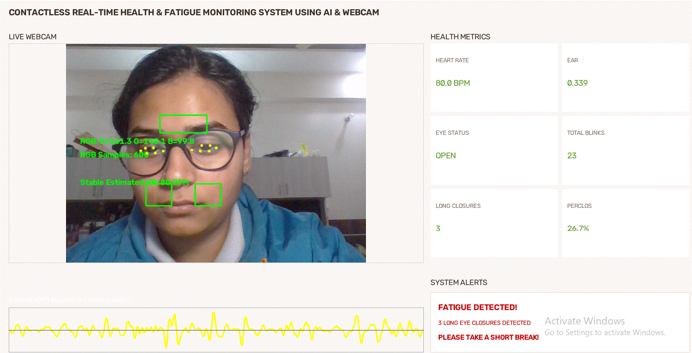
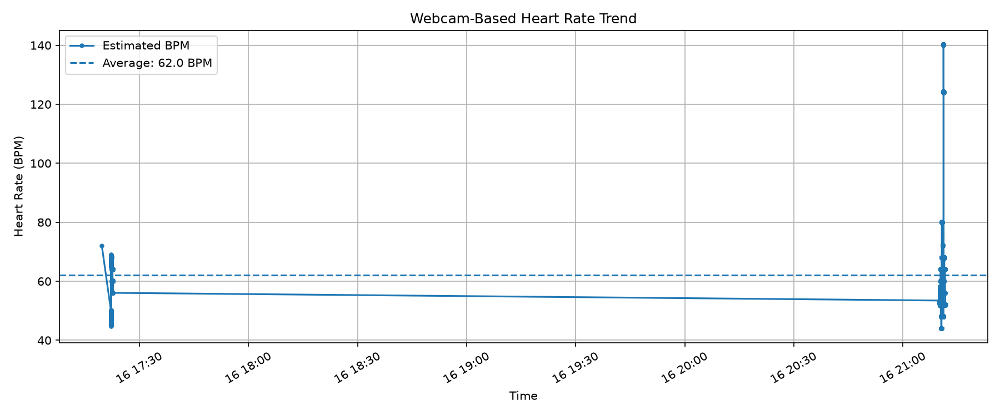
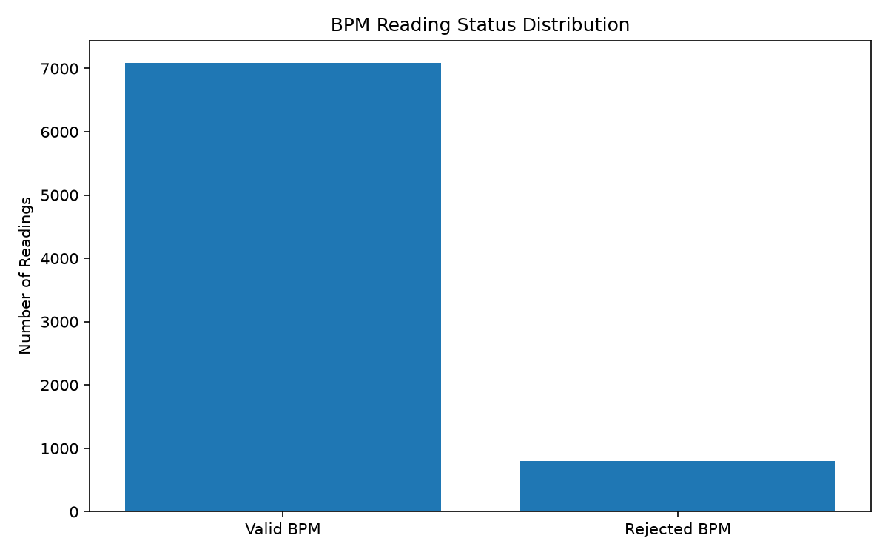

# Contactless Real-Time Health & Fatigue Monitoring System

## Project Overview

The **Contactless Real-Time Health & Fatigue Monitoring System** is an AI-based computer vision project that uses a webcam to estimate heart rate and monitor visual signs of fatigue without requiring wearable devices or physical sensors.

The system processes facial video using OpenCV and MediaPipe. It extracts facial signals to estimate heart rate using remote photoplethysmography (rPPG) and monitors eye movements using the Eye Aspect Ratio (EAR) technique.

It displays real-time monitoring information and generates alerts when potential signs of fatigue are detected.

## Dashboard Preview

The application provides a real-time dashboard for monitoring estimated heart rate and visual signs of fatigue.



## Key Features

- **Contactless Heart Rate Estimation:** Estimates heart rate (BPM) from facial video using green-channel rPPG.
- **Eye Fatigue Detection:** Uses Eye Aspect Ratio (EAR) to monitor eye closure.
- **Blink Monitoring:** Tracks total blinks and prolonged eye closures.
- **PERCLOS Monitoring:** Estimates eye-closure percentage over a monitoring window.
- **Real-Time Dashboard:** Displays webcam feed, BPM, eye status, and signal waveform.
- **Fatigue Alerts:** Generates visual alerts when configured fatigue conditions are detected.
- **Data Logging:** Stores monitoring readings for further analysis.
- **Performance Analysis:** Generates graphs and summary statistics from recorded readings.

## Technologies Used

- Python
- OpenCV
- MediaPipe
- NumPy
- SciPy
- Pandas
- Matplotlib

## Project Structure

```text
contactless-health-monitor/
│
├── main.py
├── alert_engine.py
├── requirements.txt
├── .gitignore
├── face_landmarker.task
│
├── fatigue/
│   ├── blink.py
│   └── ear.py
│
├── rppg/
│   ├── __init__.py
│   ├── data_logger.py
│   ├── heart_rate.py
│   ├── roi_signal.py
│   ├── signal_processor.py
│   └── visualization.py
│
└── analysis/
    ├── analyze_data.py
    └── results/
        ├── heart_rate_trend.png
        └── reading_status.png
```

## How It Works

### 1. Face Detection
The webcam captures live video, and MediaPipe Face Landmarker detects facial landmarks.

### 2. rPPG-Based Heart Rate Estimation
The system extracts color variations from selected facial regions. These variations are processed to estimate the pulse signal and calculate heart rate in BPM.

### 3. Eye Aspect Ratio (EAR)
Facial landmarks around the eyes are used to calculate EAR and identify whether the eyes are open or closed.

### 4. Fatigue Detection
The system monitors eye closures, blink patterns, and PERCLOS estimates to identify potential signs of fatigue.

### 5. Dashboard and Alerts
The dashboard displays monitoring information and visual warnings when configured fatigue conditions are reached.

### 6. Data Analysis
Recorded readings can be analyzed to generate heart-rate trends, reading statistics, and performance summaries.

## Installation and Setup

### Prerequisites

- Python installed on your computer
- Visual Studio Code
- Webcam
- Git

### Step 1: Clone the Repository

```bash
git clone https://github.com/191Srishti/miniproject.git
```

### Step 2: Open the Project Folder

```bash
cd miniproject
```

### Step 3: Create a Virtual Environment

```bash
python -m venv venv
```

### Step 4: Activate the Virtual Environment

For Windows PowerShell:

```powershell
.\venv\Scripts\Activate.ps1
```

### Step 5: Install Dependencies

```bash
pip install -r requirements.txt
```

### Step 6: Check the Face Landmarker Model

Ensure that `face_landmarker.task` is present in the project root directory, alongside `main.py`.

### Step 7: Run the Application

```bash
python main.py
```

Allow webcam access when prompted.

## Experimental Results

In one recorded experiment, the system produced the following results:

| Metric | Result |
|---|---:|
| Total Readings | 7,889 |
| Valid BPM Readings | 7,089 |
| Rejected BPM Readings | 800 |
| BPM Availability | 89.86% |
| Signal Availability | 99.99% |
| Average Estimated BPM | 62.01 |
| Minimum Estimated BPM | 44.00 |
| Maximum Estimated BPM | 140.28 |

These values represent one experimental run and are not clinical accuracy measurements.

### Heart Rate Trend



### Reading Status



## Applications

- Driver fatigue monitoring research
- Workplace fatigue awareness
- Computer vision-based health monitoring research
- Contactless physiological signal estimation
- Academic research and experimentation

## Limitations

- Heart rate estimation can be affected by lighting, head movement, camera quality, and skin-region visibility.
- Eye-based fatigue detection may be affected by glasses, facial movements, and camera positioning.
- The system is intended for experimental and educational purposes.
- It is not a medical device and must not be used for medical diagnosis or treatment.

## Future Enhancements

- Improve heart rate estimation stability.
- Explore advanced rPPG algorithms such as POS.
- Improve fatigue detection using additional visual features.
- Add historical monitoring reports and data visualization.
- Evaluate the system against reference heart-rate devices under controlled conditions.

## Author

**Srishti Srivastava**

MCA Student

GitHub: [191Srishti](https://github.com/191Srishti)

---

*Developed as an academic project exploring computer vision, remote physiological signal estimation, and real-time fatigue monitoring.*
